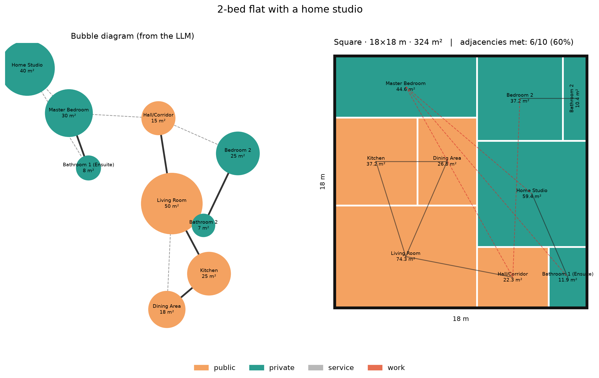

# Day 01 · Brief → Bubble Diagram → Filled Plan

Type a design brief (e.g. *"2-bed flat with a home studio"*). A **local LLM** (Ollama, `qwen2.5:14b`) returns the room programme (rooms, areas, zones, adjacencies) as structured JSON. Python draws it as an architectural **bubble diagram**, then packs the rooms into a chosen **footprint** (rectangle, square, L or U) as a first-pass plan. Everything runs offline.



## Files

| File | What it is |
|---|---|
| `bubble_diagram.ipynb` | Brief → LLM → bubble diagram, step by step with explanations |
| `bubble_to_plan.ipynb` | Extends it: pick a footprint shape and size, fill it with rooms, score adjacencies |
| `bubble.py` | Script version of the bubble diagram |
| `images/` | Example outputs |

## How it works

```
brief + footprint ──► LLM (structured JSON) ──► clean + connect graph ──► room order ──► ordered treemap ──► plan
```

- **Structured output:** a pydantic schema is passed to Ollama's `format=`, so the model must return valid JSON.
- **Prompts suggest, code enforces:** the model sometimes leaves rooms disconnected, so `connect()` links isolated clusters to the hall.
- **Filling the footprint:** shapes are lists of rectangles. Rooms are ordered by a strongest-link-first walk, then recursively split to fill each rectangle exactly.
- **Adjacency score:** the share of requested adjacencies whose rooms share at least 0.9 m of wall.

## Run it

```bash
ollama pull qwen2.5:14b
python3 -m venv .venv && source .venv/bin/activate
pip install -r requirements.txt
```
Open a notebook, select the `.venv` kernel and run all cells.

## Next

- Optimise the room order for adjacency score (search or a genetic algorithm)
- Minimum room widths, doors and windows
- Send the plan to Rhino/Grasshopper for massing
