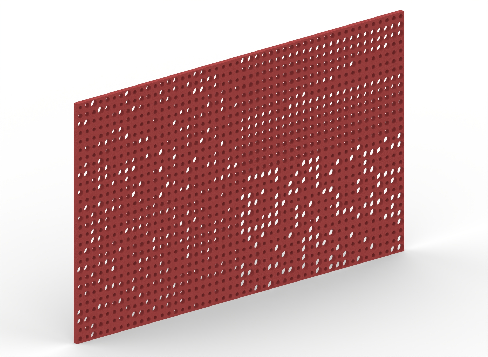

# Day 02 · AI Pattern → Parametric Facade

An AI image generator makes an abstract black-and-white pattern. Grasshopper reads the pattern's **brightness** at the centre of each facade panel and scales a circular aperture to match: bright areas open up and dark areas close. Change the prompt and you get a new facade.



## Pipeline

```
prompt ──► Draw Things (Juggernaut XL, local) ──► pattern.png ──► Image Sampler (brightness) ──► Remap ──► aperture radius ──► perforated panel
```

## Files

| File | What it is |
|---|---|
| `image_to_facade.gh` | Grasshopper definition |
| `image_to_facade.3dm` | Rhino model |
| `patterns/` | AI-generated patterns (voronoi, sand dunes, coral; two seeds each) |
| `images/grasshopper_definition.png` | Screenshot of the definition |

## How it works (Grasshopper)

1. **Facade:** an XZ-plane Rectangle becomes a Boundary Surface, reparameterized to 0–1.
2. **Panels:** Divide Domain² (24 × 14) feeds Isotrim, giving 336 panels. Area gives each panel's centre.
3. **Sample:** Surface Closest Point gives the panel's uv, which goes through Construct Point into the **Image Sampler** (channel: Brightness, domain 0–1).
4. **Apertures:** brightness is remapped to 0.05–0.45 × panel width to get the radius. Circles are drawn on an **XZ Plane** at each centre.
5. **Panel:** the outer edge and all circles are merged, then Boundary Surfaces makes one plate with holes. Extrude gives it thickness.

## Prompts

Draw Things · Juggernaut XL (SDXL) · 1024 × 1024 · negative prompt: `color, text, watermark, frame, border, blurry, people`

- `organic voronoi texture, black and white, high contrast, flat top view, seamless`
- `flowing sand dune waves, black and white gradient, minimal, top view`
- `cellular coral growth pattern, black and white, macro, high contrast`

> After cloning, re-point the Image Sampler (double-click it) to an image in `patterns/`, because the saved file path is local to my machine.

## Next

- Curved facade surfaces; louvres rotated by brightness instead of round holes
- Daylight comparison of each facade with Ladybug
- Generate the pattern from inside Grasshopper via the ComfyUI API
