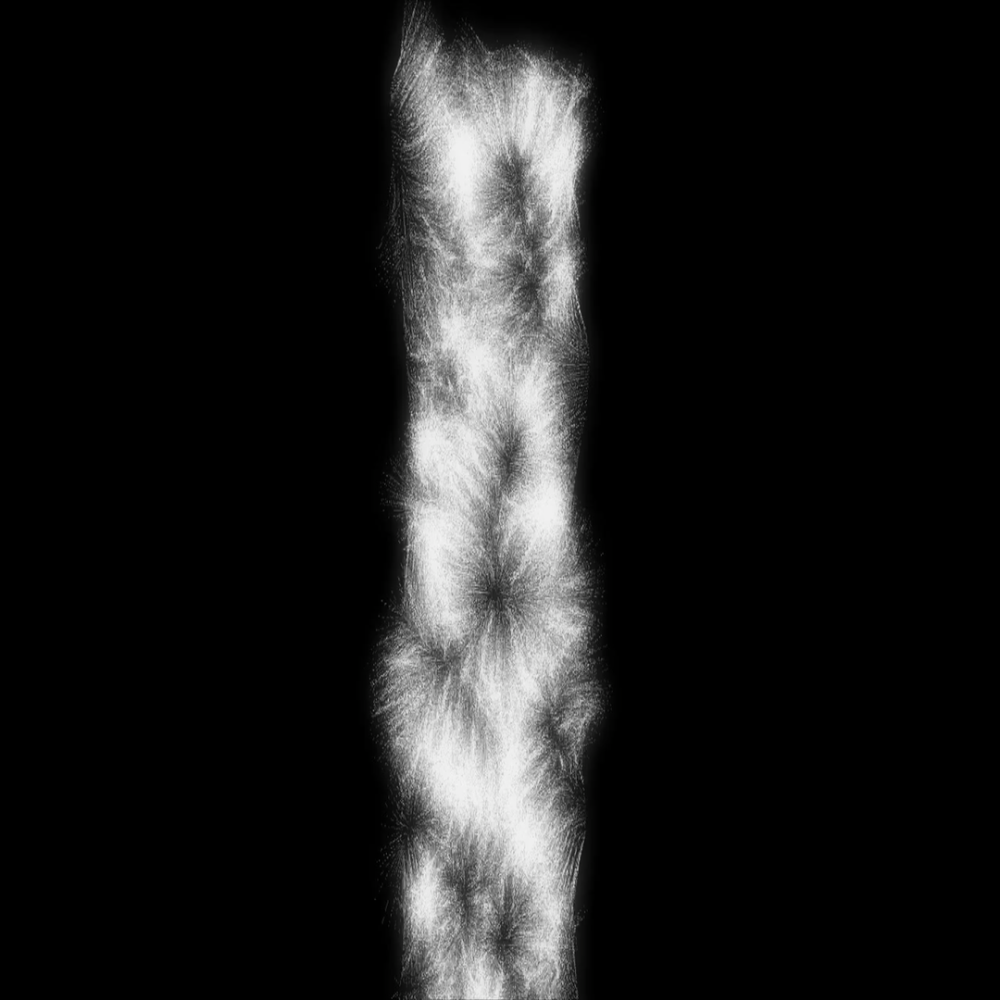

# Day 03 · Fluffy Noise in TouchDesigner

My first TouchDesigner project. Animated noise drives a piece of geometry, which is rendered with a **line material** and then blurred and screen-composited on top of itself, so it reads as fur moving in the wind.



▶ **Video:** [`media/fluffy_noise.mp4`](media/fluffy_noise.mp4)

## Network

```
SOPs + noise ──► null1 ──► geo1 (material: line1 MAT) ──► render1 (cam1, light1) ──► null2 ─┬──────────► comp1 (Screen) ──► transform1 ──► out
                                                                                        └─► blur1 ─┘
```

- **Line MAT** draws the geometry as thousands of fine strands.
- **Blur + Composite (Screen):** the sharp render and its blurred copy are screen-blended, which adds the soft glow around the fibres.

## Files

| File | What it is |
|---|---|
| `day_03.toe` | TouchDesigner project |
| `media/fluffy_noise.mp4` | 11 s render (H.264) |
| `media/still.png` | Still frame |

## Credit

Built by following the beginner tutorial **"Touchdesigner Tutorial01: Fluffy The Noise"** by bb.dere.

## Learnings

- A Render TOP finds the camera, lights and geometry through its **parameters**, not wires. `*` means "everything".
- Materials are assigned on the Geometry COMP's **Render → Material** parameter.
- A Composite TOP needs two inputs to blend; the network needed both the sharp and blurred versions.

## Next

- Make it audio-reactive (Audio Device In CHOP → noise amplitude)
