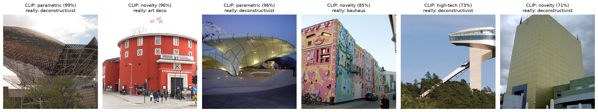

# Day 04 · Can CLIP Read Architectural Style?

49 building photos, 11 style labels, zero training. **CLIP** (`open_clip`, ViT-B-32 trained on LAION-2B) compares each photo with phrases like *"a photo of a gothic building"* and picks the closest. The grid groups photos by CLIP's guess, with wrong guesses outlined in red.

**Result: 36 / 49 correct (73%).**



| True style | Correct |
|---|---|
| Gothic | 7/7 |
| Ancient Egyptian | 7/7 |
| Novelty | 7/7 |
| Baroque | 6/7 |
| Art Deco | 4/7 |
| Bauhaus | 4/7 |
| Deconstructivist | 1/7 |

## Funniest errors

- **Frank Gehry's *Peix* (Barcelona)** → "parametric" at **99%** (dataset says deconstructivist)
- **Happy Rizzi House** (pink, hearts, cartoon faces) is labelled *Bauhaus* in the dataset; CLIP said "novelty" at 85%. Honestly, CLIP wins this one.
- **Zaha Hadid's Hungerburgbahn station** → "parametric" at 96%. Also arguably right.

Many of the "errors" are really disagreements with the dataset's labels. Style labels are fuzzy, and deconstructivist vs parametric is a debate even among architects.

## How it works

1. **List, don't download:** Kaggle's API lists the dataset's files, and only the 49 sampled photos are downloaded (~5 MB instead of 1.4 GB), cached outside the repo.
2. **Labels:** the 7 sampled styles plus 4 modern styles that aren't in the sample (brutalist, parametric, high-tech, vernacular), so CLIP can be tempted by them.
3. **Zero-shot CLIP:** image and text embeddings, then cosine similarity, then softmax over labels.
4. **Grid:** one row per predicted style, wrong guesses in red with the true label.

Full grid: [`style_grid.png`](style_grid.png) · Notebook: [`clip_style_classifier.ipynb`](clip_style_classifier.ipynb)

## Data

[Architecture dataset](https://www.kaggle.com/datasets/wwymak/architecture-dataset) on Kaggle, a mirror of the dataset from Zhe Xu et al., *Architectural Style Classification using Multinomial Latent Logistic Regression* (ECCV 2014). Images originally from Wikimedia Commons. Images are not redistributed here; the notebook downloads them.

Notes: the dataset stores every image twice (`arcDataset/` and `arcdataset/arcDataset/`), so the notebook dedupes. File names containing `%` fail to download through `kagglehub`, so they are skipped.

## Run it

```bash
python3 -m venv .venv && source .venv/bin/activate
pip install kagglehub open_clip_torch torch pillow matplotlib requests ipykernel
```
Open the notebook, select the `.venv` kernel and Run All. The first run downloads the CLIP weights (~600 MB).

## Next

- Prompt ensembling and a bigger model (ViT-L-14)
- Confusion matrix of which styles get mixed up
- Linear probe: a tiny classifier trained on CLIP features
