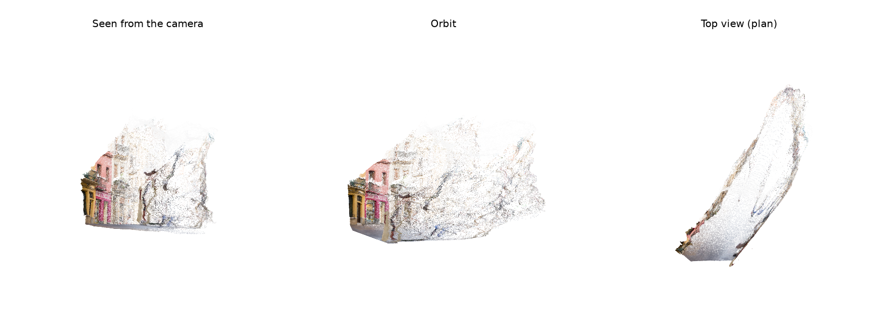

# Day 05 · One Photo → 3D Point Cloud

Upload a street or site photo. **Depth Anything V2 (Metric, Outdoor)** estimates how far away every pixel is, **in metres**. Each pixel is then lifted into 3D with its colour, shown in an interactive **Plotly** view inside a **Gradio** app, and exported as a `.ply` for Rhino, CloudCompare or Blender (reused on Day 17).


*A Barcelona street photo, rebuilt as 421,500 coloured points.*

```
photo ──► Depth Anything V2 (metric outdoor) ──► depth map (m) ──► pinhole back-projection ──► coloured points ──► Plotly view + cloud.ply
```

## Concepts

### 1. Monocular depth estimation
Humans judge depth with two eyes; a camera has one. **Monocular depth estimation** means predicting distance from a single image. The model has learned the cues we use without thinking: things get smaller with distance, parallel lines converge, objects overlap, textures get finer, and the bottom of the image is usually closer. It's an educated guess, not a measurement.

### 2. Depth Anything V2
A vision transformer trained in two stages. A large **teacher** model learns from perfectly labelled **synthetic** images (rendered 3D scenes, where depth is known exactly). It then labels millions of **real** photos, and a smaller **student** model learns from those. That's why it's sharp on edges like synthetic data, but still works on real streets. This project uses the **Small** version (~25M parameters), which runs in about a second on a Mac GPU.

### 3. Relative vs metric depth
- **Relative depth** (the standard model) only knows *nearer vs farther*. It has no units, so you can't measure anything.
- **Metric depth** (the `Metric-Outdoor` model used here) is fine-tuned on driving and street datasets, where the true distances are known, so it outputs **metres**. That's what makes the point cloud roughly real-scale and useful in Rhino.

### 4. Pinhole camera back-projection
A camera squashes 3D into 2D. With depth, we can undo it. For a pixel at column `u`, row `v` with depth `z`:

```
f = (W / 2) / tan(FOV / 2)          focal length, in pixels
x = (u − W/2) · z / f               metres to the right
y = (v − H/2) · z / f               metres down (flipped to up)
```

The **field of view (FOV)** is the hidden parameter. A phone's main camera is about 65° wide. If it's wrong, the street gets stretched or squashed; that's what the FOV slider is for.

### 5. Point clouds and `.ply`
A **point cloud** is just a list of points, each with an X, Y, Z and a colour. No surfaces, no thickness. **PLY** is a simple file format for storing them. This cloud is in **metres, Z-up** (X = right, Y = into the scene, Z = up), the same convention as Rhino, so `Import` drops it in at roughly the right scale.

### 6. Why the cloud looks like a "shell"
One photo only sees **the front surface** of everything. Behind a building there's nothing, because the camera never saw it. So the cloud is a coloured relief, not a full 3D model. Filling the gaps needs more photos from other angles (photogrammetry) or a model that imagines the hidden parts.

### 7. Known weak spots
- **Sky:** sometimes predicted as "far but finite", creating a ceiling of points. Lower **Max depth** to cut it.
- **Glass and reflections:** the model sees the reflection, not the glass.
- **Scale drift:** metric depth is an estimate. Expect ±10–20% error, more at long range.

## Files

| File | What it is |
|---|---|
| `depth_point_cloud.ipynb` | Step-by-step notebook ending in the Gradio app |
| `cloud.ply` | Exported point cloud (metres, Z-up) |
| `images/point_cloud_views.png` | Preview from three angles |
| `requirements.txt` | Python packages |

## Run it

Open3D needs Python ≤ 3.12.

```bash
python3.12 -m venv .venv && source .venv/bin/activate
pip install -r requirements.txt
```
Open the notebook, select the `.venv` kernel, set `PHOTO` to your image, and Run All. The last cell launches the app at http://127.0.0.1:7860.

## Web version

[`web/`](web/) is the same pipeline as a static website that runs fully in the browser: the model is converted to ONNX (fp16) and runs with WebGPU, and the cloud is drawn with Three.js. It's hosted on Cloudflare Pages. See [web/README.md](web/README.md).

## Next

- Read the real focal length from the photo's EXIF instead of guessing the FOV
- Mask the sky with a segmentation model
- Mesh the cloud (Open3D Poisson) and import it into Rhino
- Fuse several photos of the same site into one cloud
